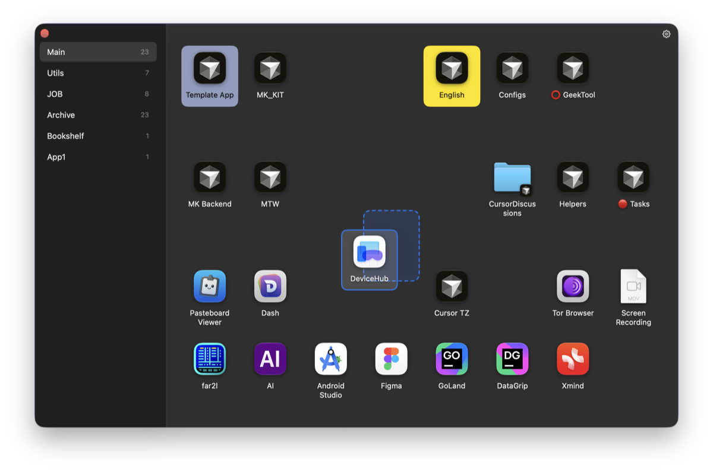
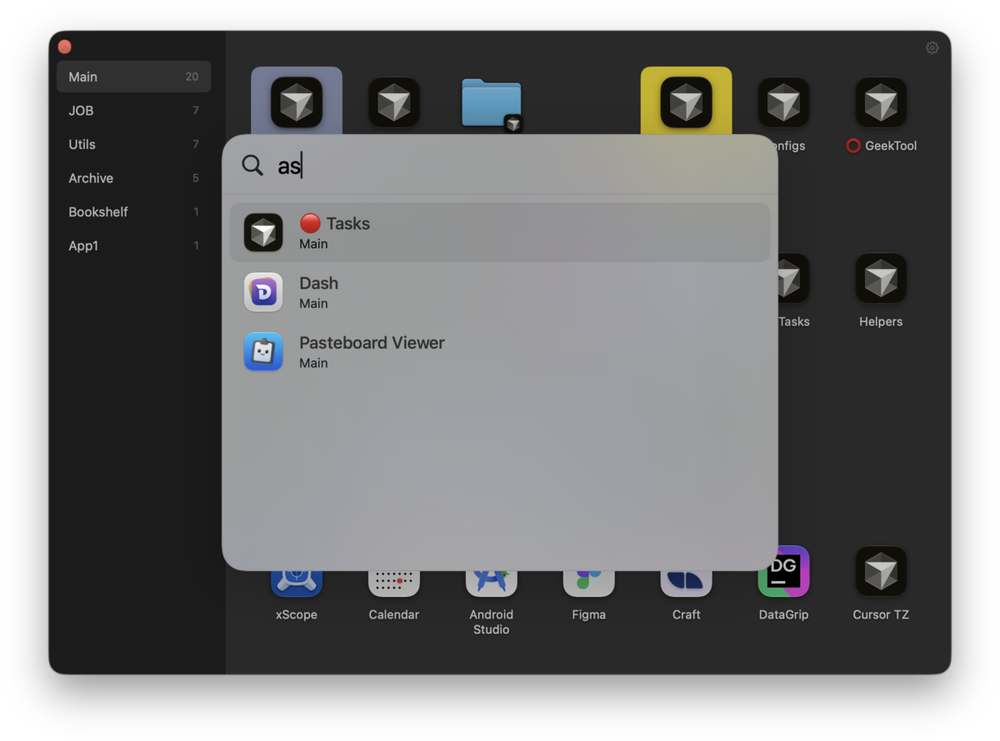

# Scatter

Yet another launch pad for macOS.

I open a lot of folders-as-projects in Cursor and didn’t want to spend time making `.code-workspace` files for each one. Drop the folder once, open it in Cursor forever — that’s why this exists.

It also grew into a menu-bar launcher for apps, files, folders, and URLs — organized into collections, laid out on a grid, and a hotkey away.

Inspired by [Overflow 3](https://stuntsoftware.com/overflow/) from Stunt Software.

<p align="center">
  
</p>

## Usage

Drop a **file**, **folder**, or **URL** onto the canvas. That’s it. Colorize a tile if you need it to stand out.

- Apps open as usual
- Files and folders open with the system default — or an app you choose
- Web links keep their favicon and open in your default browser — or one you pick via **Open With**

Type to search across every collection. Drag tiles to rearrange. Right-click the menu bar icon for quick access.

<p align="center">
  
</p>

## Special options

### Open With (and Cursor)

When you drop a file or folder, Scatter asks whether to open it with the system default or with **Cursor**. You can also pick any other app later via **Open With…**. For URLs, **Open With** lists installed browsers (one-shot or **Always Open in**).

Cursor gets first-class treatment: it’s offered on drop, resolved reliably if installed, and `.code-workspace` files show the Cursor icon. Folders and projects you live in day-to-day stay one click from the editor you actually use.

### Time zone injection

Some apps care about `TZ`. Scatter can launch them with a preferred time zone injected into the environment — opt-in per item, with the zone chosen in Settings.

Useful when you want one app to behave as if it’s in another city without changing the system clock.

## Requirements

- macOS 14+

## Build

```bash
xcodegen generate
xcodebuild -scheme Scatter -configuration Debug -derivedDataPath build build
open "build/Build/Products/Debug/Scatter.app"
```

## License

[MIT](LICENSE)
